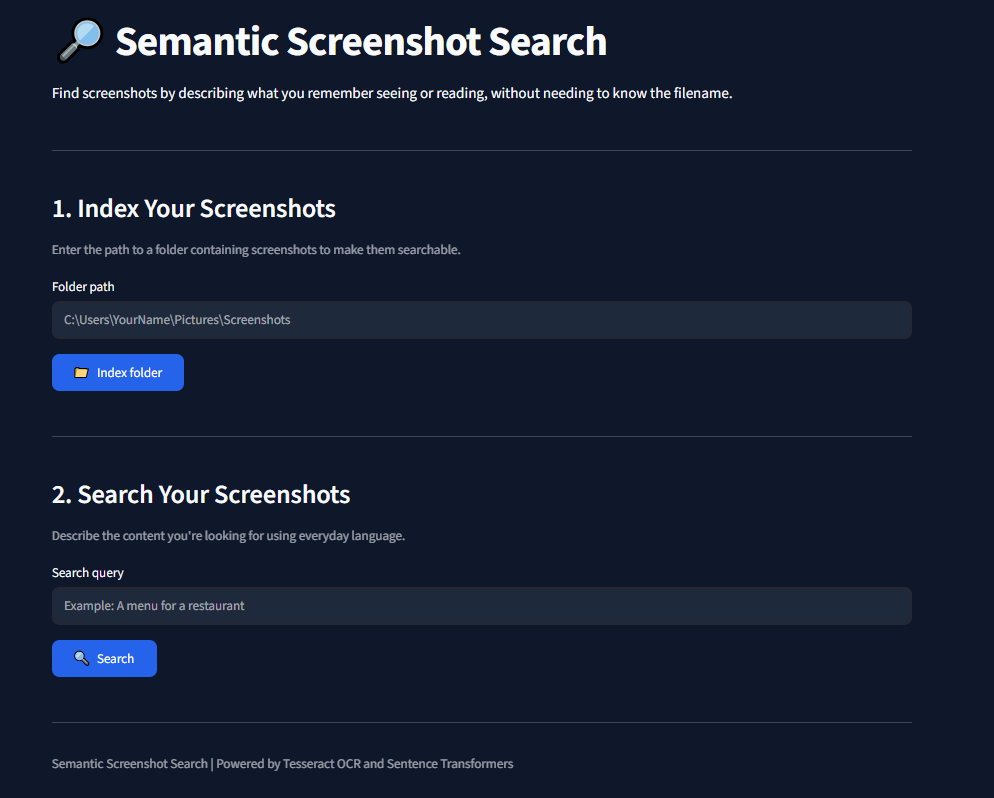
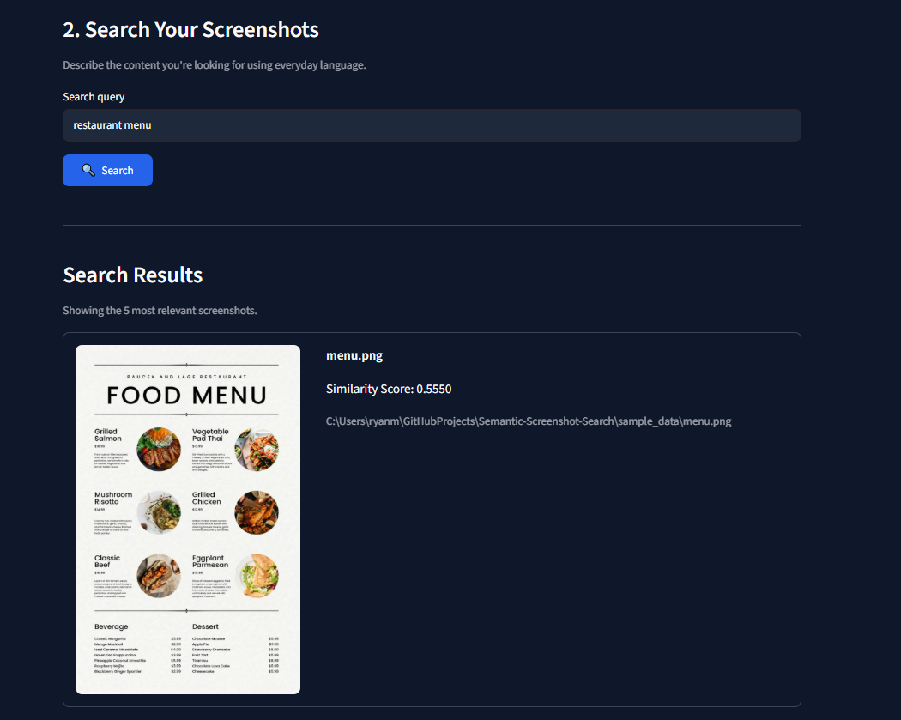

# Semantic Screenshot Search

A Python application that allows users to search for screenshots using natural-language descriptions instead of filenames.

## Problem

Finding images on your computer through the search function can be difficult since screenshots and pictures typically are given indistinct file names.

## Goal

Give users an easy way to search for screenshots by describing the information they remember seeing or reading in them.

## How It Works

The application uses Optical Character Recognition (OCR) and semantic search to identify screenshots relevant to a user's search query.

1. The user selects a folder containing screenshots.
2. Tesseract OCR extracts readable text from supported image files.
3. The extracted text and associated file information are saved in a JSON index.
4. Sentence Transformers converts the extracted text into numerical embeddings.
5. The user's search query is converted into an embedding using the same model.
6. Cosine similarity measures how closely each screenshot's text matches the search query.
7. The five highest-ranked screenshots are displayed with their filenames, similarity scores, and image previews.

Unlike traditional keyword searches, semantic search can identify relevant screenshots even when the search query does not use the exact wording found in the image.

## Technology Stack

- **Python:** Core application logic and data processing.
- **Streamlit:** Web-based user interface.
- **Tesseract OCR:** Extracting text from screenshots.
- **pytesseract:** Python interface for Tesseract OCR.
- **Pillow:** Image loading and processing.
- **Sentence Transformers:** Generating semantic text embeddings.
- **all-MiniLM-L6-v2:** Pretrained sentence embedding model.
- **Cosine Similarity:** Ranking screenshots based on semantic relevance.
- **JSON:** Storing indexed screenshot information.

## Application Preview

The application provides a Streamlit interface for indexing screenshot folders and searching their contents using natural-language queries.





## Setup

### Prerequisites

- Python 3.12
- Tesseract OCR installed on your computer
- Git (optional, for cloning the repository)

### Installation

1. Clone the repository:

   ```bash
   git clone https://github.com/RyanMcNally1/Semantic-Screenshot-Search.git
   cd Semantic-Screenshot-Search
   ```

2. Create a virtual environment:

   ```bash
   python -m venv .venv
   ```

3. Activate the virtual environment (Windows PowerShell):

   ```powershell
   .\.venv\Scripts\Activate.ps1
   ```

4. Install the required Python packages:

   ```bash
   pip install -r requirements.txt
   ```

5. Install Tesseract OCR separately and ensure its executable path is correctly configured in `src/ocr.py`.

## Usage

1. Start the Streamlit application:

   ```bash
   streamlit run src/app.py
   ```

2. Enter the path to a folder containing screenshots.
3. Click **Index folder** to extract and store text from the screenshots.
4. Enter a natural-language search query describing the screenshot you want to find.
5. Click **Search** to display the five most relevant screenshots.

Each search result includes the screenshot's filename, cosine similarity score, and image preview.

### Example Queries

- "A certificate from my robotics course"
- "A restaurant menu with different meals"
- "A programming example with Python code"
- "A fantasy game's quest journal"

## Evaluation

Evaluation is planned for the next development milestone.

The application will be tested using a collection of screenshots and queries with known relevant results.

Planned evaluation includes:

- Comparing semantic search against traditional keyword matching.
- Measuring retrieval performance using Precision@5 and Recall@5.
- Identifying false positives and cases where OCR or semantic search performs poorly.

## Limitations

- Search primarily relies on text extracted through OCR rather than visual image recognition.
- Screenshots containing little or no readable text may not be searchable.
- OCR accuracy can decrease with small, blurry, or stylized text.
- Search performance depends on the quality of the extracted text and the pretrained embedding model.
- The application currently runs locally and requires Tesseract OCR to be installed.

## Future Improvements

- Add visual embeddings to support searching images without readable text.
- Improve retrieval performance for larger screenshot collections.
- Explore FAISS for more efficient vector similarity search.
- Combine visual and text-based similarity for more accurate results.
- Improve the user interface and screenshot management features.